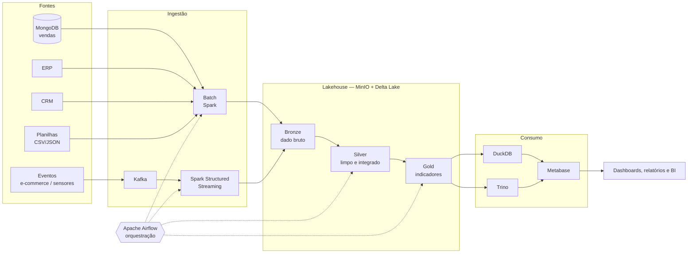

# MongoDB e Arquitetura de Big Data — NovaCompra

- **Nome:** Eduardo Rafael da Silva Suarez
- **Curso:** Sistemas de Informação
- **Instituição:** AMF
- **Data:** 19/11/2026

---

# Parte A — Prática no MongoDB

## Ambiente

```bash
docker compose up -d --wait
docker compose ps
docker compose exec mongo mongosh --quiet --eval 'db.adminCommand({ping:1})'
```

```
NAME               IMAGE     COMMAND                  SERVICE   CREATED         STATUS                   PORTS
novacompra-mongo   mongo:8   "docker-entrypoint.s…"   mongo     7 seconds ago   Up 6 seconds (healthy)   127.0.0.1:27017->27017/tcp

{ ok: 1 }
```

Carga inicial (executada uma única vez):

```bash
docker compose exec -T mongo mongosh --quiet < init.js
```

```
{
  acknowledged: true,
  insertedIds: {
    '0': ObjectId('6aff6e51776757f4061245e4'),
    '1': ObjectId('6aff6e51776757f4061245e5'),
    '2': ObjectId('6aff6e51776757f4061245e6'),
    '3': ObjectId('6aff6e51776757f4061245e7'),
    '4': ObjectId('6aff6e51776757f4061245e8'),
    '5': ObjectId('6aff6e51776757f4061245e9'),
    '6': ObjectId('6aff6e51776757f4061245ea'),
    '7': ObjectId('6aff6e51776757f4061245eb')
  }
}
Total de vendas iniciais: 8
```

## A.1 — Preparação e inserção de dados

```javascript
db.vendas.countDocuments({})
```

```
8
```

```javascript
db.vendas.findOne()
```

```
{
  _id: ObjectId('6aff6e51776757f4061245e4'),
  pedidoId: 'P1001',
  data: ISODate('2026-10-20T10:00:00.000Z'),
  canal: 'loja',
  loja: 'Santa Maria',
  clienteId: 'C01',
  itens: [
    {
      produto: 'Notebook',
      categoria: 'Informática',
      quantidade: 1,
      precoUnitario: 3200
    },
    {
      produto: 'Mouse',
      categoria: 'Acessórios',
      quantidade: 2,
      precoUnitario: 80
    }
  ],
  status: 'concluida'
}
```

### Dois campos escalares e a estrutura incorporada

RESPOSTA: (escrever)

### Justificativa: por que os itens ficam dentro do pedido

RESPOSTA: (escrever)

### Uma desvantagem dessa opção

RESPOSTA: (escrever)

## A.2 — Consultas e operações CRUD

### Consulta

```javascript
db.vendas.find({ status: "concluida" }, { _id: 0, pedidoId: 1, loja: 1, status: 1 }).sort({ pedidoId: 1 })
```

```
[
  { pedidoId: 'P1001', loja: 'Santa Maria', status: 'concluida' },
  { pedidoId: 'P1002', loja: 'E-commerce', status: 'concluida' },
  { pedidoId: 'P1003', loja: 'Porto Alegre', status: 'concluida' },
  { pedidoId: 'P1005', loja: 'Santa Maria', status: 'concluida' },
  { pedidoId: 'P1006', loja: 'E-commerce', status: 'concluida' },
  { pedidoId: 'P1007', loja: 'Porto Alegre', status: 'concluida' }
]
```

### Filtro

```javascript
db.vendas.find({ status: "concluida", loja: "Santa Maria" })
```

```
[
  {
    _id: ObjectId('6aff6e51776757f4061245e4'),
    pedidoId: 'P1001',
    data: ISODate('2026-10-20T10:00:00.000Z'),
    canal: 'loja',
    loja: 'Santa Maria',
    clienteId: 'C01',
    itens: [
      {
        produto: 'Notebook',
        categoria: 'Informática',
        quantidade: 1,
        precoUnitario: 3200
      },
      {
        produto: 'Mouse',
        categoria: 'Acessórios',
        quantidade: 2,
        precoUnitario: 80
      }
    ],
    status: 'concluida'
  },
  {
    _id: ObjectId('6aff6e51776757f4061245e8'),
    pedidoId: 'P1005',
    data: ISODate('2026-10-22T13:00:00.000Z'),
    canal: 'loja',
    loja: 'Santa Maria',
    clienteId: 'C04',
    itens: [
      {
        produto: 'Teclado',
        categoria: 'Acessórios',
        quantidade: 2,
        precoUnitario: 150
      }
    ],
    status: 'concluida'
  }
]
```

### Inserção e atualização

```javascript
db.vendas.insertOne({
  pedidoId: "P1009", data: ISODate("2026-10-24T10:00:00Z"),
  canal: "online", loja: "E-commerce", clienteId: "C06",
  itens: [{ produto: "Mouse", categoria: "Acessórios", quantidade: 1, precoUnitario: 80 }],
  status: "pendente"
})
```

```
{
  acknowledged: true,
  insertedId: ObjectId('6aff6f749242abedb98bf46b')
}
```

```javascript
db.vendas.updateOne({ pedidoId: "P1009" }, { $set: { status: "concluida" } })
db.vendas.find({ pedidoId: "P1009" }, { _id: 0, pedidoId: 1, status: 1 })
```

```
{
  acknowledged: true,
  insertedId: null,
  matchedCount: 1,
  modifiedCount: 1,
  upsertedCount: 0
}
[ { pedidoId: 'P1009', status: 'concluida' } ]
```

### Exclusão

```javascript
db.vendas.deleteOne({ pedidoId: "P1009" })
db.vendas.countDocuments({})
```

```
{ acknowledged: true, deletedCount: 1 }
8
```

## A.3 — Aggregation Pipeline

### Receita total por loja

```javascript
db.vendas.aggregate([
  { $match: { status: "concluida" } },
  { $unwind: "$itens" },
  { $group: { _id: "$loja", receita: { $sum: { $multiply: ["$itens.quantidade", "$itens.precoUnitario"] } } } },
  { $project: { _id: 0, loja: "$_id", receita: 1 } },
  { $sort: { receita: -1 } }
])
```

```
[
  { receita: 3660, loja: 'Santa Maria' },
  { receita: 3250, loja: 'E-commerce' },
  { receita: 2830, loja: 'Porto Alegre' }
]
```

### Unidades vendidas por categoria

```javascript
db.vendas.aggregate([
  { $match: { status: "concluida" } },
  { $unwind: "$itens" },
  { $group: { _id: "$itens.categoria", quantidade: { $sum: "$itens.quantidade" } } },
  { $project: { _id: 0, categoria: "$_id", quantidade: 1 } },
  { $sort: { quantidade: -1 } }
])
```

```
[
  { quantidade: 6, categoria: 'Acessórios' },
  { quantidade: 5, categoria: 'Informática' }
]
```

### Pedidos por status

```javascript
db.vendas.aggregate([
  { $group: { _id: "$status", total: { $sum: 1 } } },
  { $project: { _id: 0, status: "$_id", total: 1 } },
  { $sort: { total: -1 } }
])
```

```
[
  { total: 6, status: 'concluida' },
  { total: 1, status: 'cancelada' },
  { total: 1, status: 'pendente' }
]
```

### Efeito de cancelados e pendentes nos indicadores financeiros

RESPOSTA: (escrever)

## A.4 — Integridade e qualidade de dados

### Índice único e duplicidade

```javascript
db.vendas.createIndex({ pedidoId: 1 }, { unique: true })
```

```
pedidoId_1
```

```javascript
db.vendas.insertOne({
  pedidoId: "P1001", data: ISODate("2026-10-24T10:00:00Z"),
  canal: "loja", loja: "Santa Maria", clienteId: "C01",
  itens: [{ produto: "Mouse", categoria: "Acessórios", quantidade: 1, precoUnitario: 80 }],
  status: "concluida"
})
```

```
MongoServerError: E11000 duplicate key error collection: novacompra_avaliacao.vendas index: pedidoId_1 dup key: { pedidoId: "P1001" }
```

A contagem permaneceu em 8 após a tentativa.

### Quantidade negativa (P9999)

```javascript
db.vendas.insertOne({
  pedidoId: "P9999", data: ISODate("2026-10-24T12:00:00Z"),
  canal: "online", loja: "E-commerce", clienteId: "C99",
  itens: [{ produto: "Mouse", categoria: "Acessórios", quantidade: -2, precoUnitario: 80 }],
  status: "concluida"
})
```

```
{
  acknowledged: true,
  insertedId: ObjectId('6aff6f8cf71991d8f98942d7')
}
```

Contagem após a inserção: `9`.

Limpeza:

```javascript
db.vendas.deleteOne({ pedidoId: "P9999" })
db.vendas.countDocuments({})
```

```
{ acknowledged: true, deletedCount: 1 }
8
```

### Por que a inserção foi aceita

RESPOSTA: (escrever)

### Regra de negócio proposta para devoluções e quantidades negativas

RESPOSTA: (escrever)

### Como evitar duplicar vendas ao reprocessar um lote

RESPOSTA: (escrever)

## Verificação final

```javascript
db.vendas.countDocuments({})
db.vendas.getIndexes().map(i => i.name)
```

```
8
[ '_id_', 'pedidoId_1' ]
```

---

# Parte B — Arquitetura de Big Data

## B.1 — Fluxo da plataforma



**Legenda:** setas cheias (`-->`) = fluxo de dados; setas pontilhadas (`-.->`) = orquestração (Airflow agenda e coordena, não armazena nem processa os dados).

**Papel de cada ferramenta:** _(escrever)_

**Em qual etapa entram os documentos da coleção vendas e como seus campos viram tabela analítica:** _(escrever)_

## B.2 — Medallion, qualidade e consumo

| Camada | Que dados ficam nessa camada? | Uma transformação ou regra de qualidade | Quem usa esses dados? |
| --- | --- | --- | --- |
| Bronze | _(escrever)_ | _(escrever)_ | _(escrever)_ |
| Silver | _(escrever)_ | _(escrever)_ | _(escrever)_ |
| Gold | _(escrever)_ | _(escrever)_ | _(escrever)_ |

**Por que um pedido cancelado fica na Bronze e não entra no faturamento da Gold:** _(escrever)_

**Diferença entre Parquet e Delta Lake:** _(escrever)_

**Indicador no Metabase (campos e agrupamentos):** _(escrever)_

## B.3 — Lambda ou Kappa

**Comparação (até 4 frases):** _(escrever)_

**Arquitetura escolhida e justificativa:** _(escrever)_

**Como os dados processados chegam à Gold:** _(escrever)_
